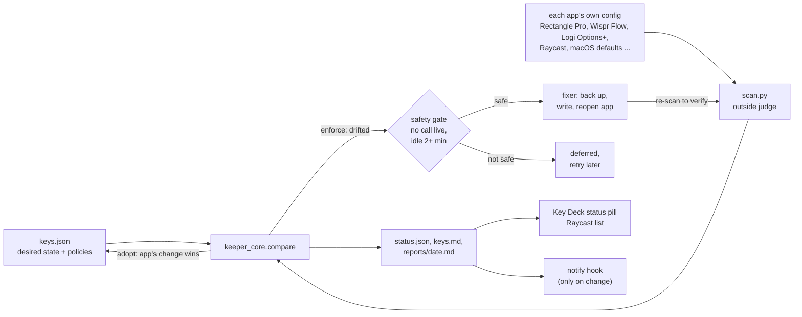

# Shortcut Keeper

[](https://github.com/gkmr/shortcut-keeper/actions/workflows/tests.yml)   [](LICENSE)

Desired-state-as-code for macOS keyboard and mouse shortcuts: a declared state, an independent scanner, per-key
policies, safe auto-repair and a daily report.

## The problem

Shortcuts drift because apps rewrite their own configs. An update resets a hotkey, a new app grabs a key another app
already owns, a migration quietly moves the launcher. I run a mouse-first Mac (Caps Lock as a Hyper key, a window
manager, two dictation apps, a mouse that sends shortcuts from its gesture button) and I kept finding out about drift
the bad way: mid-call, when a key did nothing or did the wrong thing. So I started treating shortcuts like
infrastructure: write down what every key should be, read what the apps really have, and reconcile every day.

My own `keys.json` holds 106 shortcuts, gestures and ring slots across 16 apps and tools (Raycast, Rectangle Pro,
Wispr Flow, Logi Options+, macOS and others). It has run on a daily schedule since 2026-10-20.

## How it works



1. **Desired state.** `keys.json` has one entry per shortcut with a `policy`: `enforce` (restore it), `adopt` (the
   app's new key becomes the desired state), `watch` (report only), and optionally `pending` (a to-do for me). Every
   field is described in [docs/schema.md](docs/schema.md).
2. **Outside judge.** `scan.py` reads the actual bindings from each app's own files: Wispr Flow's `config.json`,
   BetterWispr's `workspace.json`, Rectangle Pro and TickTick preferences (Cocoa flags, keyed archives), apps built on the
   KeyboardShortcuts library, Logi Options+'s SQLite settings, Raycast's Hyper key state and Key Deck's own hotkey file.
   Apps that hide their keys (Raycast's encrypted database, Gemini) are listed in `manual.json` and checked on screen
   once a week.
3. **Compare.** `keeper_core.compare` turns the difference into issues (high, medium, todo, low, info) and changes:
   drift on an enforced key, an adopted move, a shortcut nobody declared, two running apps on one key, an app on a key
   macOS reserves, an app that was uninstalled. Rules cover what is not a single key (Hyper key on, Spotlight off, a
   LaunchAgent loaded, the snap panel in sync).
4. **Repair, safely.** `keeper.py --fix` restores enforced keys only when no call is live and I have not touched the
   keyboard or mouse for 2 minutes. Each fixer backs the file up, quits the app, writes, reopens it, and then keeper
   re-reads the real config. A fix counts only when the scan agrees.
5. **Report.** `status.json` feeds the status pill on Key Deck and the Raycast list, `keys.md` is the printable sheet,
   `reports/<date>.md` is the daily report and `reports/CHANGELOG.md` the history. A healthy run with no change is silent.

Around the keeper:

- **Key Deck** (`keydeck/KeyDeck.swift`, one file, about 3,300 lines): a mouse-first cheat sheet. Caps + / shows every
  shortcut on one screen with pictures of where each window goes; each tile has a one-key badge, so I press one letter
  or click instead of remembering a chord. Its status pill shows the last check. It also runs Webcam Mode (the call
  window under the camera, pinned on top).
- **Meeting Director** (`director.sh`, `layout.py`, `rectsync.py`): when a call starts it finds the real call window
  (Zoom, Meet, Teams, Webex, Slack huddle, WhatsApp, FaceTime, Phone), lays out the meeting apps from the same
  `keys.json` blocks, pins the call under the camera, starts the note-taking apps' notetakers (BetterWispr, Wispr Flow)
  and puts everything back when the call ends.

  > **Consent.** The Director starts recorders and notetakers automatically when it sees a call. Tell the people on the
  > call that they are being recorded or transcribed, and follow the consent laws where you and they are (some places
  > require everyone's consent). If you cannot do that every time, set `DIRECTOR_NO_BW=1` where director.sh runs, so it lays out
  > windows but starts no notetaker.
- **Raycast extension** (`raycast-ext/`, "My Keys"): opens Key Deck, or searches shortcuts by words and runs one.
- **Small helpers** (`bin/*.swift`): window lists from the window server, Accessibility presses, the processes on the mic.
- **The daily run** is a scheduled agent following [docs/runbook.md](docs/runbook.md), or a plain LaunchAgent
  (`examples/launchd/`).

## Quickstart

Linux or macOS, python3 and bash only:

```bash
git clone https://github.com/gkmr/shortcut-keeper.git
cd shortcut-keeper
tests/run_all.sh                       # ends with ALL SUITES PASS
```

Replay the injected-drift fixture through the real `keeper.py`, in a scratch folder (nothing on your machine is read
or changed):

```bash
export SHORTCUT_KEEPER_HOME="$(mktemp -d)"
cp examples/keys.example.json "$SHORTCUT_KEEPER_HOME/keys.json"
SHORTCUT_KEEPER_SCAN_JSON=examples/fixtures/scan-healthy.json python3 keeper.py
#   All shortcuts healthy, 1 to-do for you
SHORTCUT_KEEPER_SCAN_JSON=examples/fixtures/scan-drift.json python3 keeper.py
#   3 issues: Rectangle Pro "Top center sixth: the call box" should be Caps Y but is ⌃⌥Y
cat "$SHORTCUT_KEEPER_HOME/reports/$(date +%F).md"
```

On a Mac, from the clone (outputs land next to the code and are gitignored):

```bash
cp examples/keys.example.json keys.json         # then make it yours
cp examples/keydeck.example.json keydeck.json
cp examples/manual.example.json manual.json
python3 scan.py                                 # what your apps really have; clashes flagged
python3 keeper.py                               # compare; writes status.json, keys.md, reports/
python3 keeper.py --fix                         # restore enforced keys when it is safe
for f in bin/*.swift; do swiftc -O -o "${f%.swift}" "$f"; done
keydeck/build.sh                                # builds ~/Applications/Key Deck.app
```

Optional hooks: `SHORTCUT_KEEPER_NOTIFY` (a command keeper runs with the summary when something changed, see
`examples/notify-example.sh`) and `SHORTCUT_KEEPER_CALL_HOOK` (a command whose output says "recording" while your call
recorder runs, so fixes wait).

## How it is verified

The scanner is the judge, not the sheet: keeper never trusts `keys.json`, `keys.md` or Key Deck as evidence that a key
works, and a fix is confirmed only by a second scan of the real config files.

What runs here (`tests/run_all.sh`, python3 stdlib and bash, no network, no real app configs):

| Suite | What it checks | Result |
|:--|:--|:--|
| `tests/test_keeper_core.py` | the diff on fixtures: enforce drift is high with its fixer, adopt follows the app, new keys are added as watch items, clashes (including keys only keys.json knows), reserved keys, uninstalled apps, the safety gate, the snap panel order | 25 tests pass |
| `tests/test_keeper_e2e.py` | the real `keeper.py` on a replayed scan in a temp folder: the healthy run is quiet and rewrites nothing; the drifted run with `--fix` during a call defers, touches nothing, adopts and logs | 3 tests pass |
| `tests/layout-test.py` | the four meeting layouts: on screen, app minimum sizes, no overlaps, the call box under the camera, nothing floating over the notes app | 168 checks pass |
| `tests/director-test.sh` | call detection from fake window lists and mic users (a Meet tab with a code, a huddle pop-out, an idle FaceTime window is not a call) | 38 cases pass |
| `tests/recheck-test.sh` | the background recheck during a call (late call found, pin moves to the next call, a tab switch keeps the pin) | 5 steps pass |

What ran on the real Mac:

- The first clean run exited 0. An injected drift (the webcam key expected as Caps Q) was caught as **high** with the
  Rectangle Pro fixer attached, and the fix was **deferred because I was active** at the keyboard.
- 15 daily reports from 2026-10-20 to 2026-11-04; the latest run checked 106 keys with 0 high and 0 medium issues.
- `tests/macos/` holds the on-screen tests (they open test pages, pin and move real windows): never run on a schedule.

## Design decisions and tradeoffs

- **An independent scanner over a self-reported state.** Reading each app's own files means writing decoders (Cocoa and
  Carbon modifier flags, keyed archives, SQLite). The payoff is that drift is caught where it happens. Apps that encrypt
  their settings get a weekly on-screen check instead, so they can be up to a week stale.
- **A policy per key, not one global "restore".** `adopt` keeps me from fighting my own changes made in an app's UI,
  and `watch` keeps defaults visible without alarms. The cost: an accidental change to an adopt key is accepted, so
  adopt is only for low-stakes keys.
- **Fix only when it cannot hurt.** Fixers quit and reopen apps, so they wait for no call and 2 idle minutes, with up to
  two retries in the agent run. Drift can therefore stay open until the next day.
- **One source for every copy.** Key Deck's tiles, Rectangle Pro's snap panel and meeting layouts, `layout.py` and the
  Raycast list are all generated from `keys.json`, and two rules check that the generated copies still match.
- **A pure core.** `keeper_core.py` has no I/O, so the comparison runs on Linux against fixtures. The macOS parts
  (scanner reads, fixers, Accessibility) stay thin around it.
- **Quiet by default.** No message when healthy; the status pill is the ambient signal and the notify hook fires only on
  change or when I need to act.

## Limitations

- macOS only at run time. `scan.py`, the fixers, Key Deck and the Director need macOS; on Linux only the core, the
  fixtures and the fake-window tests run. Off macOS, keeper skips rules and says so in one info line.
- Decoders follow each app's current config format. When an app changes it, the scan reports a read error (a medium
  issue) until the decoder is updated. Only Wispr Flow, BetterWispr and Rectangle Pro have key fixers.
- Key Deck and the Meeting Director are built around my own meeting apps (Krisp, Granola, Wispr Flow, BetterWispr,
  Claude, Floaty) and screens (a 2056 x 1243 pt laptop and an ultrawide). They are not compiled by these tests (no
  Swift on Linux) and need editing for another setup.
- Clash text for Hyper keys reads "hyper w" instead of "Caps W" (clash combos are lower case). Cosmetic; kept as in
  production.
- The Raycast extension ships without its icon (add `raycast-ext/assets/icon.png` before `ray build`) and uses
  `@raycast/api` at `latest`.
- Independent project. It reads other apps' settings files and is not affiliated with any of those vendors.

## Layout

```
shortcut-keeper/
├── keeper.py              daily check: compare, fix when safe, write status, sheet and report
├── keeper_core.py         pure diff logic, clash rule, snap panel, safety gate (tested on Linux)
├── scan.py                outside judge: reads actual bindings from each app's config files
├── layout.py              places the meeting apps from keys.json deck blocks
├── rectsync.py            keeps Rectangle Pro's copy of the meeting layouts in sync
├── director.sh            Meeting Director: detect the call window, lay out, pin, undo
├── bin/                   Swift helpers (window lists, AX press, mic users) and one JXA script
├── keydeck/               Key Deck: KeyDeck.swift, Info.plist, build.sh
├── raycast-ext/           Raycast "My Keys" extension: package.json, tsconfig.json, src/
├── docs/                  schema.md (every keys.json field), runbook.md (the daily agent run)
├── examples/              keys.example.json, keydeck and manual examples, notify hook, launchd/
│   └── fixtures/          scan-healthy.json, scan-drift.json, layouts.json
└── tests/                 run_all.sh, unit and end-to-end tests, layout and Director tests
    └── macos/             on-screen tests (move and pin real windows; never scheduled)
```
